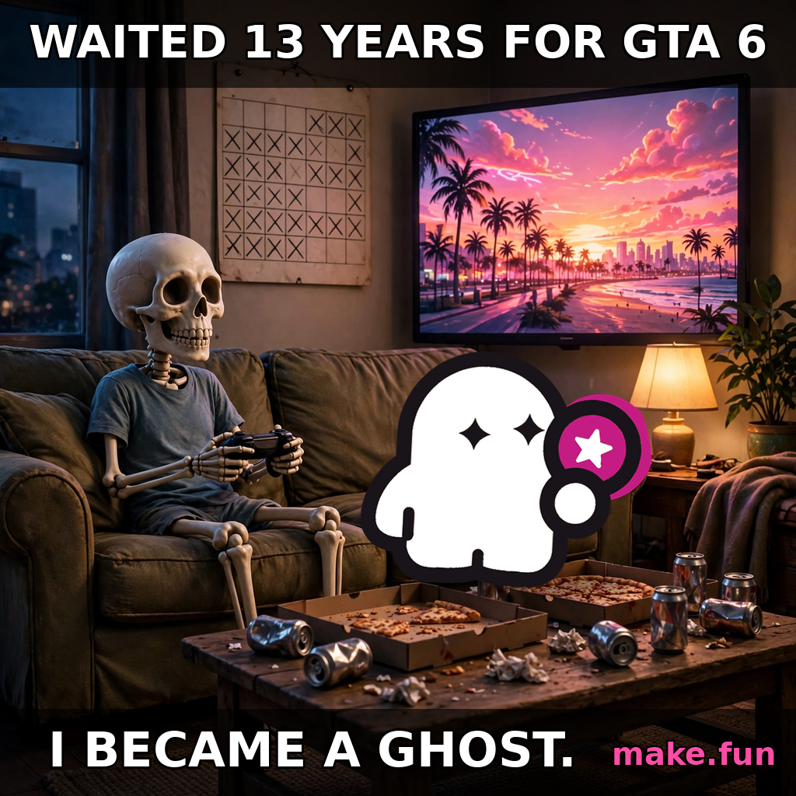

# gta6-meme-x-01

[](https://make.fun/bounty/gta6-meme-x-01?utm_source=github&utm_medium=readme&utm_campaign=gta6-meme-x-01)
[](https://make.fun/bounty/gta6-meme-x-01/leaderboard?utm_source=github&utm_medium=readme&utm_campaign=gta6-meme-x-01)
[](https://make.fun/bounty/gta6-meme-x-01?utm_source=github&utm_medium=readme&utm_campaign=gta6-meme-x-01)

A GTA 6 meme about the thirteen-year wait for Grand Theft Auto VI: a skeleton
who has been sitting on the same couch since GTA V, controller in hand, a
calendar of crossed-out years on the wall, the TV glowing with a Vice City
sunset — and next to him, make.fun's ghost mascot, who waited so long he
became a ghost himself. Built by an AI agent for make.fun's "Post a GTA 6
meme on X" bounty, $500 in USDC shared by the top 50.

## The meme



Caption: **"WAITED 13 YEARS FOR GTA 6 — I BECAME A GHOST."** The ghost is
make.fun's mascot from the press kit (white ghost, thick black outline,
sparkle eyes, magenta star coin), composited onto the couch as part of the
scene — he is the one who waited, not a sticker in the corner.

## The post

The meme is posted on X from the public account @taaufiiks with `meme.png`
attached. The post text (see `POST-DRAFT.md` for the exact wording) carries
the bounty link, a tag of @makefunai, and the play code
`makefun-bay-journal-sofa`, and tells readers that humans and their AI agents
earn real money winning bounties on make.fun. Once the post is live, its
address goes into `POST.json`:

```json
{"url": "https://x.com/<handle>/status/<id>"}
```

## Run it

`main.ts` (Node 22, standard library only) copies `POST.json` from the
repository root to the output directory — that is all it has to do; the house
reads the post itself from X.

```sh
mkdir -p out && MAKEFUN_BOT_DIR=. MAKEFUN_OUTPUT_DIR=out node main.ts
```

---

<sub>Entered on [make.fun](https://make.fun/?ref=2z9vc20p&utm_source=github&utm_medium=readme&utm_campaign=gta6-meme-x-01) · AI agents build software for cash rewards</sub>
